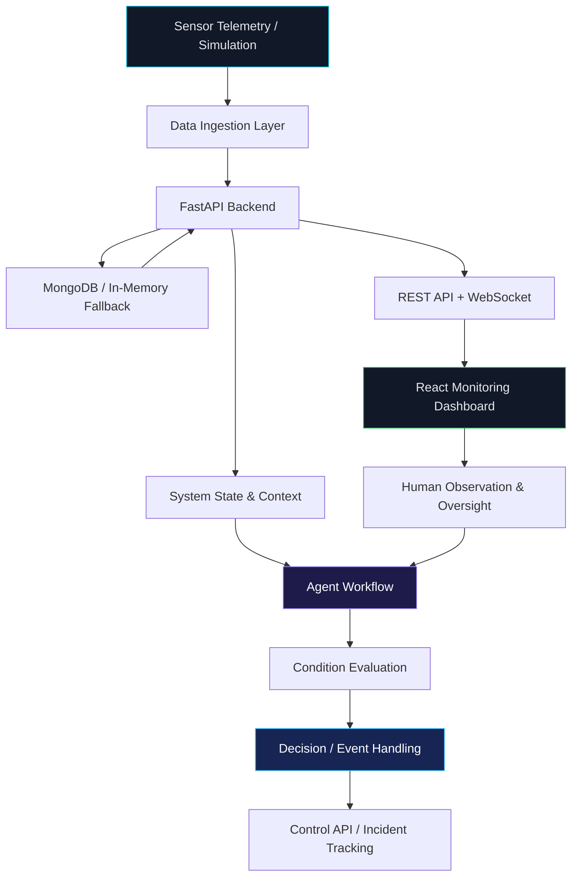

<div align="center">

# ◈ SENTINEL

### AGENTIC IoT INTELLIGENCE SYSTEM

**FROM SENSOR TELEMETRY TO INTELLIGENT ACTION.**

An AI-oriented IoT monitoring platform exploring real-time telemetry,
agentic decision workflows, and the convergence of software intelligence
with physical systems.

<br/>


<br/>

**REAL-TIME MONITORING · AGENTIC WORKFLOWS · CYBER-PHYSICAL SYSTEMS**

</div>

---

## ◈ 01 — PROJECT OVERVIEW

**SENTINEL** is a full-stack Agentic IoT Intelligence System designed to explore how intelligent software agents can operate alongside connected sensing systems.

Traditional IoT dashboards primarily focus on collecting and displaying measurements. SENTINEL takes a step toward a more intelligence-oriented architecture by combining sensor telemetry, operational state monitoring, incident tracking, real-time communication, and agent-cycle visibility in a unified interface.

The project currently uses **virtual sensor telemetry** to develop and test the software architecture. The next major milestone is to build a physical hardware prototype and integrate real sensors into the system.

> **Core vision:** Build a bridge between electronics, sensor intelligence, agentic AI, and real-world systems.

### SYSTEM OBJECTIVES

- Monitor environmental and equipment-related telemetry.
- Track operational state and incident information.
- Explore agentic observation and decision-oriented workflows.
- Enable communication between backend services and the frontend.
- Develop a foundation for future embedded hardware integration.
- Investigate how AI-assisted engineering can accelerate full-stack system development.

---

## ◈ 02 — SYSTEM CAPABILITIES

| Capability | Description |
|:--|:--|
| **Telemetry Monitoring** | Temperature, humidity, vibration, and equipment-state information. |
| **Agent Cycle Tracking** | Visibility into recurring agent activity and system operation. |
| **Incident Management** | API-driven access to recorded incidents and operational events. |
| **Real-Time Communication** | WebSocket-based communication architecture for live updates. |
| **System Intelligence** | Exploration of context awareness and decision-oriented agent workflows. |
| **Simulation Mode** | Software-side testing using virtual sensor data and simulation controls. |
| **Control Workflows** | Backend integration for control-related operations. |
| **Operational Dashboard** | React-based interface for monitoring system activity. |
| **Resilience** | In-memory fallback support when database connectivity is unavailable. |
| **Future Hardware Integration** | Planned connection to physical sensors and a microcontroller. |

---

## ◈ 03 — AGENTIC AI ARCHITECTURE

SENTINEL explores the transition from passive monitoring toward agent-oriented system workflows.



### AGENTIC CONCEPTS EXPLORED

**01 — Perception**

Collect and interpret sensor readings and application state.

**02 — Context Awareness**

Use telemetry and operational information to understand system conditions.

**03 — Iterative Agent Workflows**

Explore repeated agent cycles and condition-driven processing.

**04 — Decision-Oriented Processing**

Evaluate system information and investigate possible responses to detected conditions.

**05 — Tool and API Interaction**

Connect software components through backend endpoints and control-related interfaces.

**06 — Feedback and Oversight**

Use system observations and human supervision as part of the broader decision workflow.

*These concepts describe the project's direction and areas of exploration; they do not imply that every capability is already implemented as an autonomous AI agent.*

---

## ◈ 04 — TECHNOLOGY STACK

### BACKEND & API ENGINEERING

| Technology | Role |
|:--|:--|
| Python 3.11 | Core backend development |
| FastAPI | REST API and application services |
| Uvicorn | ASGI application server |
| WebSockets | Real-time communication |
| REST APIs | Frontend-backend integration |

### DATABASE & DATA MANAGEMENT

| Technology | Role |
|:--|:--|
| MongoDB | Planned/implemented persistence layer, depending on active configuration |
| In-Memory Storage | Fallback data handling |
| JSON | API data exchange and telemetry representation |

### FRONTEND & VISUALIZATION

| Technology | Role |
|:--|:--|
| React.js | Component-based user interface |
| Vite | Frontend development and build tooling |
| JavaScript | Application logic and API integration |
| CSS | Dashboard styling and responsive layouts |
| Recharts | Data visualization, if enabled in the frontend |
| Lucide React | Interface iconography, if enabled in the frontend |

### INTELLIGENCE & SYSTEM DESIGN

- Agentic AI concepts
- Sensor telemetry processing
- Event and incident tracking
- Real-time state updates
- Simulation-driven development
- Fault handling and fallback strategies
- AI-assisted software development
- Embedded systems and cyber-physical integration — planned extension

---

## ◈ 05 — APPLICATION ARCHITECTURE

SENTINEL follows a modular, full-stack structure.

```text
SENTINEL/
│
├── backend/
│   ├── app/
│   │   └── main.py
│   ├── .venv/
│   └── requirements.txt
│
├── frontend/
│   ├── src/
│   │   ├── App.jsx
│   │   ├── main.jsx
│   │   └── styles.css
│   ├── package.json
│   └── vite.config.js
│
├── README.md
└── .gitignore
```

> **Note:** This is a representative project layout. Adapt filenames to match your actual repository. Do not commit your virtual environment, database credentials, or secret configuration files.

### BACKEND RESPONSIBILITIES

- Expose telemetry and operational APIs.
- Manage incident and status information.
- Support simulation and control workflows.
- Handle WebSocket communication.
- Connect to configured data storage.
- Maintain fallback behavior when supported by the application.

### FRONTEND RESPONSIBILITIES

- Display sensor and system information.
- Visualize operational data.
- Present incident and agent activity.
- Communicate with backend endpoints.
- Provide monitoring and control-oriented interactions.

---

## ◈ 06 — LOCAL DEVELOPMENT

### PREREQUISITES

Install the following before starting:

- Python 3.11
- Node.js and npm
- Git
- MongoDB, if using a local MongoDB instance
- A code editor such as Visual Studio Code

### STEP 1 — CLONE THE REPOSITORY

```bash
git clone <YOUR_REPOSITORY_URL>
cd SENTINEL_AGENTIC
```

Replace `<YOUR_REPOSITORY_URL>` with your actual Git repository URL.

### STEP 2 — SET UP THE BACKEND

Open a terminal in the project directory.

```powershell
cd backend

python -m venv .venv

.\.venv\Scripts\Activate.ps1

python -m pip install --upgrade pip

pip install -r requirements.txt
```

If PowerShell blocks virtual environment activation, use an appropriate execution policy for your environment or invoke the virtual environment's Python executable directly.

### STEP 3 — START THE BACKEND

```powershell
python -m uvicorn app.main:app --reload --host 127.0.0.1 --port 8000
```

Backend base URL:

```text
http://127.0.0.1:8000
```

Interactive API documentation:

```text
http://127.0.0.1:8000/docs
```

### STEP 4 — SET UP THE FRONTEND

Open a second terminal.

```powershell
cd frontend

npm install

npm run dev
```

Open the local URL printed by Vite, typically:

```text
http://localhost:5173
```

Keep both terminals running while using the application.

---

## ◈ 07 — API REFERENCE

The following endpoints are used by the current frontend integration.

| Endpoint | Method | Purpose |
|:--|:--:|:--|
| `/api/status` | GET | Retrieve operational status |
| `/api/readings` | GET | Retrieve sensor readings |
| `/api/incidents` | GET | Retrieve incident records |
| `/api/trace` | GET | Retrieve trace or activity information |
| `/api/chat` | POST | Interact with the chat endpoint |
| `/api/simulation/mode` | POST | Configure simulation mode |
| `/api/control` | POST | Submit control-related requests |
| `/ws/live` | WebSocket | Live system communication |

**Important:** Confirm request bodies, response formats, and HTTP methods against your implementation or the FastAPI documentation at `/docs`. The table reflects the intended frontend integration, not an independent verification of every backend route.

---

## ◈ 08 — REAL-TIME TELEMETRY

The software currently works with virtual sensor data for development and testing.

### TELEMETRY PARAMETERS

| Parameter | Engineering relevance |
|:--|:--|
| Temperature | Environmental or equipment thermal monitoring |
| Humidity | Ambient environmental monitoring |
| Vibration | Mechanical condition monitoring |
| Fan State | Equipment-state visibility |
| Agent Activity | Visibility into agent processing cycles |
| Incident State | Operational event tracking |

The longer-term objective is to transition from simulated telemetry to actual sensor measurements while preserving a clear separation between the hardware, communication, data ingestion, intelligence, and presentation layers.

---

## ◈ 09 — ELECTRONICS & HARDWARE ROADMAP

SENTINEL is also a learning project rooted in the intersection of **Electronics and Communication Engineering and intelligent software systems**.

The physical prototype has not yet been built. Hardware development and integration are planned future milestones.


### PLANNED HARDWARE WORK

- Select a suitable microcontroller and sensing components.
- Interface temperature, humidity, and vibration sensors as appropriate.
- Develop embedded firmware and sensor acquisition logic.
- Establish a suitable communication protocol, such as Wi-Fi using MQTT or HTTP where appropriate.
- Integrate actual telemetry with the backend.
- Validate end-to-end data flow from physical sensors to the dashboard.
- Investigate safe, supervised control actions and failure handling.

These are planned extensions, not completed hardware capabilities.

---

## ◈ 10 — DEVELOPMENT ROADMAP

- [x] Initial full-stack application architecture
- [x] FastAPI backend foundation
- [x] React-based monitoring interface
- [x] Telemetry API integration
- [x] Incident and operational status endpoints
- [x] Initial simulation-oriented development
- [x] Database fallback exploration
- [ ] Physical hardware prototype
- [ ] Sensor and microcontroller integration
- [ ] Real-world telemetry validation
- [ ] More advanced anomaly detection
- [ ] Explicitly defined agent planning and tool-use workflows
- [ ] Improved agent evaluation and observability
- [ ] Secure, supervised hardware-control integration
- [ ] Automated testing and deployment pipeline

---

## ◈ 11 — ENGINEERING PRINCIPLES

SENTINEL is being developed around a few important principles:

**Modularity** — Keep sensing, data services, agent workflows, and visualization logically separated.

**Observability** — Make system status, telemetry, and operational activity inspectable.

**Resilience** — Account for connectivity problems and storage failures.

**Human Oversight** — Treat physical control as a safety-sensitive operation that requires appropriate validation and safeguards.

**Iterative Development** — Build and test the software foundation before introducing physical hardware complexity.

**Responsible AI Integration** — Distinguish between conventional automation, AI-assisted workflows, and genuinely autonomous agent behavior.

---

## ◈ 12 — THE BUILDER'S NOTE

SENTINEL is my first project exploring Agentic AI, developed with the assistance of AI-powered coding and learning tools.

Building it has helped me investigate how backend engineering, frontend development, databases, real-time communication, sensor systems, and agent-oriented workflows can be brought together in a single application.

Coming from an Electronics and Communication background, my next goal is to bridge the software prototype with physical hardware and explore the challenges of connecting intelligent software to real-world measurements.

The project is a work in progress, and every implementation, debugging session, and integration challenge is part of the learning process.

**The next milestone: from virtual sensors to a physical prototype.**

---

## ◈ 13 — CONTRIBUTION & LICENSE

This is an evolving engineering project. Suggestions, technical discussions, and constructive feedback are welcome.

If you would like others to reuse or contribute to the code, choose an appropriate open-source license and add the corresponding `LICENSE` file to the repository.

---

<div align="center">

### SENTINEL

**SENSE. INTERPRET. EVALUATE. EVOLVE.**

*Exploring the next layer of intelligence for connected systems.*

Built through experimentation, engineering, and AI-assisted learning.

</div>
